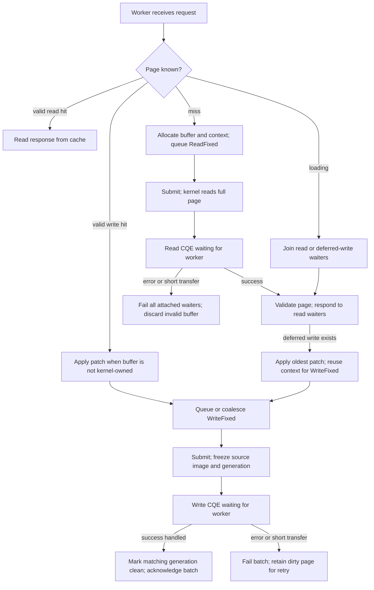

# Slab worker and kernel state machine

The entry point is [`model/KvellModel/SlabIO.lean`](../model/KvellModel/SlabIO.lean),
a small Veil wrapper around separate executable state machines. It describes
the intended single-worker protocol in `src/storage/slab.rs`, including
the page cache and the read-before-write continuation. The Rust dispatch and CQE
handlers are still incomplete, so this is a design contract, not a proof of the
current Rust implementation.

Run from `model/`:

```sh
nix develop ..#model
lake build
lake build KvellModel.Checks
```

The ordinary build runs four finite-state searches. The explicit checks target
also runs named end-to-end scenarios, checking invariants after every step.
No claim of an unbounded invariant or liveness proof is made by these checks.

## Exporting the graph

From the repository root:

```sh
nix develop .#model
python3 scripts/export-model.py
xdg-open model/.lake/fsm/protocol.overview.svg
```

The exporter imports and executes `Protocol.lean` through `Event.run`, the same
event alphabet used by Veil. It rebuilds dependencies first; there is no second
implementation of the transition rules or source-text parser to keep in sync.

Outputs under `model/.lake/fsm/`:

- `protocol.dot`: exact reachable states and all enabled, parameterized events.
  Node tooltips include the full state. Red nodes indicate violations/deadlocks,
  green nodes quiescence, and amber nodes an exploration boundary.
- `protocol.json`: the same graph, full states, event catalog, bounds, completion
  status, and source hashes, for inspection or other visualization tools.
- `protocol.overview.dot` / `.svg`: observed transitions projected onto individual
  request, cache-buffer, I/O-context, and file-image states. This deliberately
  merges identities/data and other components: paths in the overview need not
  correspond to a possible concrete execution. It is a reading aid, not a proof.

Defaults are one page, one buffer/context, two requests, and two Boolean cells.
Exploration uses structural equality to resolve state-hash collisions. The
default state limit is 10,000; `--max-states 0` removes it. A limited export is
explicitly marked incomplete; omitted successors have null targets in JSON and
a boundary node in DOT. `--max-depth N` also records unexpanded frontier nodes.
“Complete” always means complete for the chosen bounds and initial image.

```sh
# Concurrent pages and contexts; exhaust the finite instance.
python3 scripts/export-model.py --pages 2 --buffers 2 --slots 2 --cells 1 --max-states 0
# Render the full graph too, using a small instance for readability.
python3 scripts/export-model.py --requests 1 --render both --out /tmp/small-protocol
# Check exporter completeness, limit handling, and deadlock reporting.
python3 scripts/test_fsm_graph.py
```

Graphviz and Python are included in the flake. Use `--render none` to export DOT
and JSON without Graphviz; `--from-jsonl PATH` renders a saved explorer stream.
Exit status is 1 for a discovered safety violation/deadlock, 2 for a tool error,
and 0 otherwise; automation should also inspect `summary.complete` for truncation.

## Machine boundaries

| Module | Owns |
|---|---|
| [PageCache](../model/KvellModel/PageCache.lean) | Absent/loading/clean/dirty page states; reservation, patching, cleaning, eviction |
| [Transport](../model/KvellModel/Transport.lean) | Context slots and their SQ → kernel → CQ lifecycle; FIFO queues, buffer pins, submitted images |
| [Worker](../model/KvellModel/Worker.lean) | Caller tokens, read waiters, ordered deferred writes, write batches, responses |
| [Kernel](../model/KvellModel/Kernel.lean) | File images and full/partial transfers |
| [Protocol](../model/KvellModel/Protocol.lean) | Atomic handshakes between those machines, especially read-CQE → patch → write-SQE |
| [SlabIO](../model/KvellModel/SlabIO.lean) | Veil's nondeterministic event scheduler, safety declarations, finite-state checks |

Each component has a Lean state type and guarded transitions returning
`Option State`. A disabled transition returns `none`. `Protocol` composes those
transitions atomically; it never exposes intermediate states. Veil explores the
reachable product of the machines. These are separate executable components,
not independent Veil proofs with an established compositional proof rule.

[Event](../model/KvellModel/Event.lean) bounds the available IDs using `Fin`.
[Safety](../model/KvellModel/Safety.lean) checks the cross-machine properties;
local properties stay beside their respective machines.

## State and ownership

| State | Meaning / Rust counterpart |
|---|---|
| Request token, kind, page, patch, arrival ticket, phase | `SlabRequest`; caller identity is distinct from the context slot |
| Cache entry, validity, contents, dirty bit, generation | `PageCacheManager`, `Page`, `PageDescriptor` |
| Buffer identity | A registered `PagePool` slot; cache and context ownership keep it alive |
| Context slot, kind, buffer, submitted image/generation | `ContextTable` / `OpContext`; the slot is SQE `user_data` |
| FIFO submission queue | Work staged by `Engine::push`, not yet handed to the kernel |
| Kernel-active contexts | Submitted operations; independent pages may complete in either order |
| FIFO completion queue and result | CQEs waiting for `Engine::drain_cqes` / worker handling |
| Per-page waiting reads and writes | `InFlightReads` waiters and generalized deferred writes |
| `visible` | Specification-only reference page, updated by logical patches |
| `disk` | Completed or partially transferred file contents, without crash-durability claims |

Each page has at most one cached/loading buffer and at most one active I/O.
A loading entry is discoverable for deduplication but is not a readable cache hit.
The logical pin lasts across SQ, kernel execution, and CQ, until CQE handling.
For a read, the inaccessible DMA result is represented by the context's image
until the worker validates it and installs it in the cache. This abstracts away
the physical arrival of bytes in an unreadable loading buffer.

## Paths



### Read hit, miss, and deduplication

`accept` introduces a request. `dispatchCached` either returns valid contents,
joins an outstanding read, or queues a write patch. `dispatchMiss` needs a free
buffer and context, creates one loading entry, and queues one read. Later requests
for the same page join it without allocating another context or issuing another
read. Dispatch follows arrival order; applying waiting writes follows arrival
order on each page.

`submit` transfers one SQ prefix element to the kernel. Several consecutive steps
abstract a batch; a shorter prefix abstracts partial submission. An unsuccessful
submission changes no state. Kernel completion and worker CQE handling are
separate transitions: a populated DMA buffer is not usable until the worker
handles the successful read CQE.

### Write to an uncached page

`dispatchMiss` queues a **read**, preserving the request's patch as a deferred
write. `chainReadToWrite` handles the successful read CQE atomically:

1. Make the loaded page valid and complete the readers attached to this read.
2. Apply the oldest deferred patch, preserving the other cells.
3. Increment the page generation and mark it dirty.
4. Reuse the consumed read's context slot to queue `WriteFixed` on the same buffer.

No write acknowledgment occurs here. This works even with one context slot: the
continuation cannot deadlock waiting for an additional slot. It represents a
worker continuation after a read CQE, not a kernel `IOSQE_IO_LINK` chain.

### Coalescing and writes arriving during I/O

`applyWrite` can merge more waiting patches while a write is still in the worker's
SQ. `submit` freezes the final image and generation, and associates the currently
buffered requests with that write. They all complete when that write's CQE is
handled. Overlapping patches are applied in arrival order; an earlier request may
be superseded by a later patch in the same batch.

Once submitted, the source buffer cannot be modified until its CQE is handled.
Writes arriving during that interval wait for the next batch. Cache reads may
still read that valid buffer: both the worker and kernel are reading it.

This is the chosen single-buffer protocol. Generation comparison alone does not
make concurrent mutation of a DMA source safe. Allowing such mutation would need
a separate write snapshot or another explicit buffer-ownership protocol.

### Completion, errors, and eviction

The agreed write acknowledgment point is **worker handling of a successful,
full-page write CQE**. Kernel completion alone does not respond. `reapWrite` only
clears dirty state for the matching generation.

`kernelWriteCell` allows partial disk updates before a failed or short write.
`reapWrite` fails those requests once, leaves the cache dirty, and permits an
internal retry through `prepareWrite`. A retry cannot respond to the failed
requests again. Failed writes are not rolled back from the visible cache; this
is an explicit error policy, rather than an atomic-write promise.

A failed/short prerequisite read fails all its attached read and write waiters,
releases the context and invalid buffer, and never queues the deferred write.
Requests not yet dispatched remain queued and may independently retry the page.

Eviction chooses any clean, valid, unpinned page with no attached work. A buffer
or context slot can subsequently be reused. S3-FIFO's frequency counters and
small/main/ghost ranking are abstracted: the safety obligations must hold for
any eligible replacement choice. Waiting requests can stay queued under cache
or ring pressure while kernel and completion actions remain enabled.

## Checked properties

- A page has one buffer; a buffer has at most one active I/O context.
- Every active context pins a cached buffer; SQ/CQ membership matches context
  stage, with no duplicate slots.
- Loading pages cannot be read as cache hits; dirty pages are valid.
- Valid cache contents equal the logical reference page, and clean contents
  equal disk. Kernel-owned write contents and generation equal the submitted image.
- Read responses match the logical page at their response point.
- Requests receive at most one response, and responses have terminal phases.
- A successful write response requires its write transfer, never just a read.
- Read waiters and submitted writes retain the corresponding I/O ownership.

Deadlock checking permits quiescence when requests are finished or unissued,
contexts are free, and no page remains dirty. This does not establish eventual
completion under an unfair scheduler or indefinitely failing storage.

The finite searches use `(pages, buffers, contexts, requests, cells)` bounds of
`(1,1,1,1,2)`, `(1,1,1,2,2)`, `(2,1,1,2,1)`, and `(2,2,2,2,1)`.
They search to exhaustion without a depth limit. Initial page cells alternate
false/true, and accepted writes can choose either value. Caller tokens are not
reused, so the number of logical updates is bounded, even though I/O retry and
cache/slot reuse can form cycles. Checks do not enumerate every initial image.

## Implementation gaps and model boundaries

- `read_page`, `write_page`, and `handle_completions` are incomplete. The model
  supplies intended transitions rather than treating their current no-ops as the
  database protocol. `InFlightWrites` is also only a declaration at present.
- Rust currently stores one `DeferredWrite` per read context. The specification
  permits multiple waiting writes and orders them; that requires corresponding
  pending-write bookkeeping in the implementation.
- `S3Fifo` currently evicts generic values without checking dirty state or pins.
  The model's eligible-eviction guards are required cache/worker integration
  behavior. `Rc<PageDescriptor>` preserves allocation lifetime but alone does
  not preserve dirty data or prevent two buffers for one page.
- Only registered pool buffers are modeled. `PageDescriptor::new` currently
  falls back to heap memory; such memory cannot simply be used with the pool's
  `ReadFixed`/`WriteFixed` registration. A fallback strategy needs a separate
  registration or non-fixed I/O path, or explicit backpressure.
- The context capacity is the finite `slot` domain. Rust's `free_top: u8`
  initialized with `RING_DEPTH as u8` wraps 256 to zero; the model uses no such
  wrapping counter. This code issue is recorded, not silently copied into the spec.
- Pages consist of abstract Boolean cells. Two-cell checks exercise preserving
  untouched data across partial patches; byte layout, alignment, and pointer
  lifetime are separate implementation obligations. Request payloads are owned
  values in the model, whereas Rust retains raw pointers for deferred writes.
- Generations and arrival tickets do not wrap. Caller tokens name one request;
  buffer and context slots are reusable. Duplicate/spurious CQEs, cancellation,
  shutdown, fsync, crashes, recovery, and SPSC memory ordering are outside scope.
- The model assumes one slab worker owns the cache and no other writer modifies
  the slab file. `disk` is an I/O-level image, not guaranteed persistent media.
